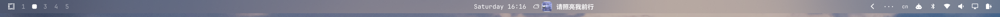
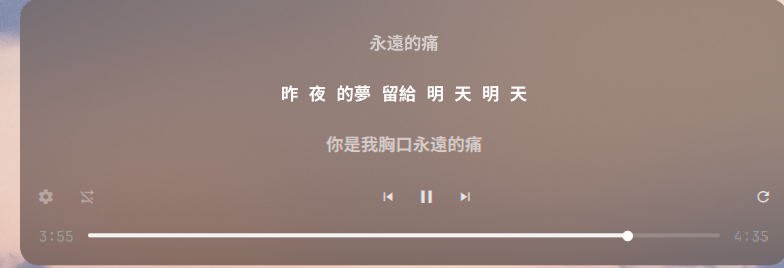

# omarchy-lyrics-rs

[](LICENSE)

-41CD52?logo=qt&logoColor=white)

**Karaoke-style lyrics for the Omarchy top bar**, rewritten in Rust. While music is playing, the bar shows the album art thumbnail plus the current lyric line with word-by-word highlighting; click it to open a floating lyrics panel.

| Top bar | Lyrics panel |
|---|---|
|  |  |

> 🌏 简体中文说明见 [README.zh-CN.md](README.zh-CN.md)

## Features

- **Top-bar lyrics** — rounded album-art thumbnail + current line, blends flat into the Omarchy bar (width animates on track change)
- **Word-level karaoke** — sung words bright & bold, unsung words dimmed, advancing word by word (sources: lrc.red / karalyr / NetEase, raced concurrently)
- **Multi-source fallback** — word-level → LRCLIB line-synced → LRCLIB plain text → "no lyrics" (widget never disappears); LRCLIB 5xx errors back off and retry automatically
- **Spotify ad detection** — when a Spotify ad plays, no lyrics lookup is wasted; the ad copy is shown in the bar instead
- **Mouse gestures** (on the bar widget) — left-click toggles the panel, right-click play/pause, middle-click next track, scroll wheel switches tracks (configurable to volume)
- **Lyrics panel** — open by clicking the widget (or `omarchy shell local.lyrics-rs panel`); a **3-row scrolling viewport** with the current line always locked in the center, all lines bold and centered, overlong lines ellipsized; click any line to seek there
- **Panel controls** — shuffle / repeat (all · one) / previous / play-pause / next / re-match lyrics + a seek bar; the seek bar is a custom-drawn, theme-colored control (Apple-Music style, no accent blue). Note: the official Spotify Linux client ignores MPRIS writes to Shuffle/LoopStatus, so on Spotify those two buttons show the real state but clicks have no effect (mpv/VLC etc. work fully)
- **Apple Music-style panel** — neutral white/gray palette, current line brightest, non-current lines dimmed by distance
- **Robust by design** — all the fragile logic (DBus, HTTP, lyric timing, type parsing) lives in the Rust backend `lyricsd`; QML only renders. If the backend crashes it restarts with exponential backoff

## Installation

Requirements: Omarchy (Quickshell 0.3+), Rust toolchain (to build the backend).

```bash
# 1. Build and install the backend
git clone https://github.com/windy664/omarchy-lyrics-rs.git
cd omarchy-lyrics-rs/backend
cargo build --release
cp target/release/lyricsd ~/.local/bin/

# 2. Install the plugin
omarchy plugin add https://github.com/windy664/omarchy-lyrics-rs --enable
```

Then add the **Lyrics** widget to the top bar in Omarchy settings.

## Configuration

Keys live in the `local.lyrics-rs` widget entry of `~/.config/omarchy/shell.json` (or use `omarchy bar set`). Values are fault-tolerant: booleans stored as strings still work.

| Key | Description | Default |
|-----|-------------|---------|
| `hideWhenIdle` | Hide the widget when nothing is playing (paused); set `false` to keep the current line visible while paused | `true` |
| `panelWidthPercent` | Lyrics panel width (percentage of screen) | `30` |
| `wheelAction` | Scroll-wheel action: `track` switch track / `volume` adjust volume / `none` | `track` |

Panel height always fits its content (3 lyric rows + control bar); there is no height setting.

### CLI

```bash
omarchy shell local.lyrics-rs panel    # toggle the lyrics panel
omarchy shell local.lyrics-rs refresh  # force a lyrics re-lookup (bypasses cache)
omarchy shell local.lyrics-rs status   # JSON status: track / line / source / shuffle / loop …
```

## Lyrics sources

Five providers race concurrently; the first answer with usable timing wins:

| Priority | Source | Notes |
|----------|--------|-------|
| 1 | lrc.red | Apple Music TTML word-level timing |
| 1 | karalyr.com | Open karaoke library, word-level (Enhanced LRC) |
| 1 | NetEase Cloud Music (line:netease) | Line-synced, high hit rate for Chinese songs |
| 2 | lrclib.net | Line-synced lyrics (with 5xx backoff retry) |
| 3 | lrclib.net | Plain text, evenly distributed over the track duration |

Results are cached on disk per track + duration (15 s buckets) under `~/.local/state/omarchy-lyrics-rs/`.

## Relationship to the original plugin

Feature parity target: [crmne/omarchy-lyrics](https://github.com/crmne/omarchy-lyrics). It was rewritten because the original didn't render its bar widget on Omarchy 4.0.6 ([issue #22](https://github.com/crmne/omarchy-lyrics/issues/22)) and got no response. Architecturally, everything that can fail (DBus, HTTP, lyric positioning, type parsing) was moved into Rust, and QML only renders — which makes the original's invisibility bug (settings stored as the string `"false"` not being treated as a boolean) impossible by construction. Development notes live in [docs/](docs/00-背景.md) (Chinese).

## License

[MIT](LICENSE)
