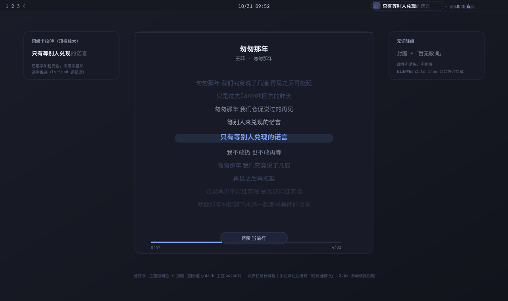

# omarchy-lyrics-rs

Omarchy 顶栏歌词插件（Rust 重写版）：正在播放时，顶栏右侧显示 **封面缩略图 + 当前歌词条**，词级歌词逐字点亮卡拉OK，点击展开歌词全文。



## 特性

- **顶栏歌词**：封面（20px 圆角）+ 当前行，扁平融入 Omarchy 顶栏，换行带宽度动画
- **词级卡拉OK**：已唱字加粗亮色、未唱字置灰，逐字推进（源：lrc.red / karalyr / 网易，词轴并发竞争）
- **多源降级**：词级 → LRCLIB 行级同步 → LRCLIB 纯文本 → “暂无歌词”（部件不消失）；LRCLIB 5xx 自动退避重试
- **Spotify 广告识别**：检测到广告时不去查词源，顶栏直接显示广告文案，不误报“暂无歌词”
- **鼠标手势**（顶栏小部件上）：左键开/关歌词面板，右键播放/暂停，中键下一曲，滚轮切歌（可改调音量）
- **歌词面板**：点击小部件（或 `omarchy shell local.lyrics-rs panel`）展开；**3 行滚动视窗**，正在唱的行永远锁在正中间，其余行上下滚动，超长行省略号截断；点击任意行跳播
- **面板控制条**：上一曲 / 播放暂停 / 下一曲 + 进度条拖动 seek
- **主题跟随**：颜色全部取自 Omarchy 主题，昼夜切换无需重载
- **稳定设计**：DBus/HTTP/时间同步全在 Rust 后端 lyricsd，QML 只渲染；后端崩溃指数退避自动重启

## 安装

依赖：Omarchy（Quickshell 0.3+）、Rust 工具链（构建后端）。

```bash
# 1. 构建并安装后端
git clone https://github.com/windy664/omarchy-lyrics-rs.git
cd omarchy-lyrics-rs/backend
cargo build --release
cp target/release/lyricsd ~/.local/bin/

# 2. 安装插件
omarchy plugin add https://github.com/windy664/omarchy-lyrics-rs --enable
```

在 Omarchy 设置里把 **Lyrics** 小部件加到顶栏即可。

## 设置

在 `~/.config/omarchy/shell.json` 的顶栏布局里给 `local.lyrics-rs` 加键（或 `omarchy bar set`），值即使看起来是布尔也按字符串容错：

| 键 | 说明 | 默认 |
|----|------|------|
| `hideWhenIdle` | 无播放（暂停）时隐藏小部件；设为 `false` 则暂停时保留当前行 | `true` |
| `panelWidthPercent` | 歌词面板宽度（屏幕百分比） | `30` |
| `wheelAction` | 滚轮动作：`track` 切歌 / `volume` 调音量 / `none` | `track` |

面板高度自动贴合内容（3 行歌词 + 控制条），无高度设置项。

## 歌词源

四路并发竞争，先返回且带时间轴的赢：

| 优先级 | 源 | 说明 |
|--------|-----|------|
| 1 | lrc.red | Apple Music TTML 词级时间轴 |
| 1 | karalyr.com | 开放卡拉OK库，词级（Enhanced LRC） |
| 1 | 网易云音乐（line:netease） | 行级同步，中文歌命中率高 |
| 2 | lrclib.net | 行级同步歌词（带 5xx 退避重试） |
| 3 | lrclib.net | 纯文本按时长均分 |

查询结果按曲目+时长（15 秒桶）落盘缓存于 `~/.local/state/omarchy-lyrics-rs/`。

## 与原插件的关系

功能对标 [crmne/omarchy-lyrics](https://github.com/crmne/omarchy-lyrics)，因其在 Omarchy 4.0.6 上顶栏不渲染（[issue #22](https://github.com/crmne/omarchy-lyrics/issues/22)）且无回应而重写。架构上把会出错的逻辑（DBus、HTTP、歌词定位、类型解析）全部移入 Rust，QML 只做渲染——原插件的隐身 bug（设置存字符串 `"false"` 不被当布尔）在这套架构下天然免疫。开发过程分析见 [docs/](docs/00-背景.md)。

## License

[MIT](LICENSE)
